<!--
  Shivam Koushik — GitHub profile, v2
  Direction: bento grid, type-first, tactile outlines, one cobalt accent with soft pastels.
  All visuals are hand-made animated SVGs in /assets (CSS animation inside the SVG),
  so there are no third-party image services to break or rate-limit.
-->

 

  

 

<table width="100%">
  <tr>
    <td width="64%" valign="top"></td>
    <td width="36%" valign="top"></td>
  </tr>
</table>

## Shipped on GitHub

<table width="100%">
  <tr>
    <td width="50%"></td>
    <td width="50%"></td>
  </tr>
  <tr>
    <td></td>
    <td></td>
  </tr>
  <tr>
    <td></td>
    <td></td>
  </tr>
</table>

## Off the clock

## Say hello

 

